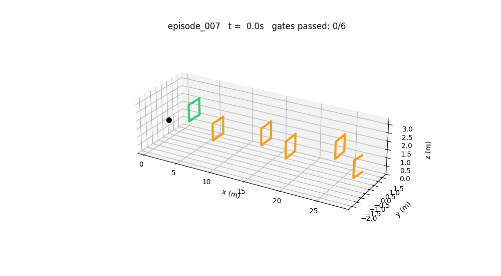
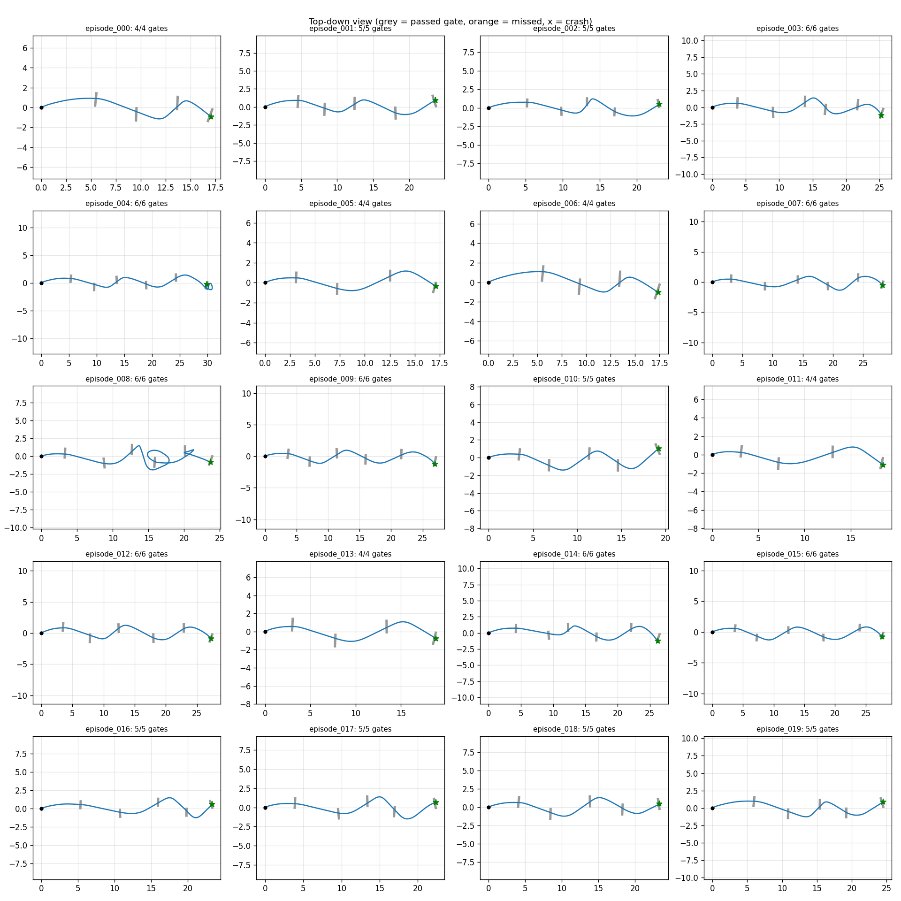
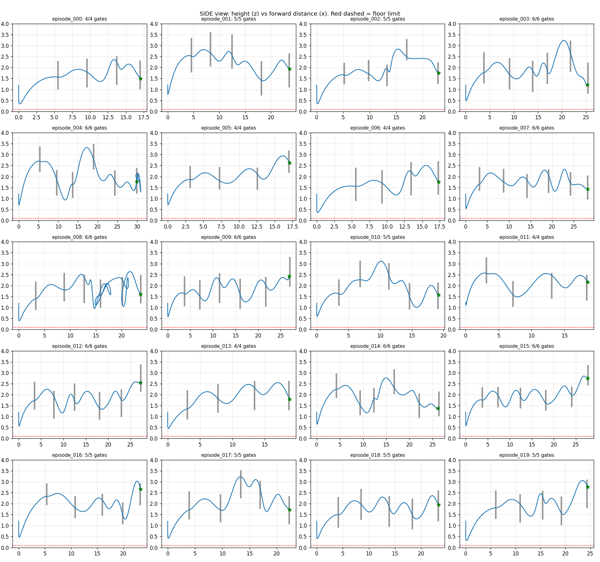

# Drone Racing with Reinforcement Learning

A quadcopter learns to race through gate courses using **reinforcement learning (PPO)** in **NVIDIA Isaac Lab**. Every episode generates a new random course (4 to 6 gates in a zigzag, with different heights and gate sizes), so the drone has to learn a general racing skill instead of memorising one track.

The long-term goal is to deploy the policy on a real 7-inch racing drone (CUAV X25 EVO flight controller, Jetson Orin Nano, Intel RealSense).



## Current results (v7)

Evaluated on 20 new random courses that the drone has never seen:

| Metric | Result |
|---|---|
| Courses finished | **20/20 (100%)** |
| Average lap time | **6.2 s** (4 to 6 gates) |
| Average speed | **4.64 m/s** |
| Gate precision | **37%** off-centre on average (0% = dead centre, 100% = touching the edge) |



## How the drone improved

Each version changed one or two things, trained for about 17 minutes (4000 PPO iterations, 4096 parallel drones, about 393 million simulation steps), and was then measured.

| Version | What changed | Gates passed | Courses finished |
|---|---|---|---|
| v1 | Gates face the racing line; gate direction given relative to the drone | 1.96 | 0% |
| v2 | Crash penalty (-30), less exploration noise | 0.87 | 0% |
| v4 | Drone can see its own height and the next gate; reward for staying alive; gentler zigzag | 1.84 | 0% |
| v5 | Crash penalty raised to -150 | 4.50 | ~70% |
| v6 | Time costs points, smaller speed penalty, bonus for passing gates near the centre | 4.68 | 90% (9.0 s laps) |
| v7 | Penalty on fast spinning for smoother turns; spawn height 1.2 m | 4.91 | **100% (6.2 s laps)** |

*Gates passed = average during training. Finished % for v6 and v7 is from evaluation flights.*

### Lessons learned

**1. Reward hacking.** In v4 every flight had the same shape when viewed from the side: a perfect arch, like a thrown ball. The drone had learned to launch itself through two gates and then fall, because two gate bonuses were worth much more than the -30 crash penalty. Raising the penalty to -150 removed the loophole, and the finish rate jumped from 0% to about 70%.

**2. The drone could not see the floor.** The original observations described the gate but not the drone's own height. Adding height and the position of the next gate let it plan turns and stop hitting the ground.

**3. Smooth is fast.** v6 overshot the turns and made small loops near the gates. Penalising fast spinning in v7 removed most loops and cut lap times by about a third, even though speed itself was not rewarded more.



## How it works

- **Simulator:** NVIDIA Isaac Lab 2.3.2 on Isaac Sim 4.5, running in Docker on an RTX 4070 laptop GPU
- **Algorithm:** PPO from RSL-RL, actor and critic networks with two hidden layers of 128 units, observation normalisation
- **Observations (19):** body-frame linear and angular velocity, gravity direction, position of the current gate, gate direction, progress through the course, position of the next gate, height above the floor
- **Actions (4):** collective thrust and three body torques
- **Rewards:** progress towards the current gate, gate pass bonus (scaled by how centred the pass is), small time cost, crash penalty, small penalties on speed and spin
- **Episode ends:** course finished, floor or ceiling hit, or 20 seconds passed

## Visualising flights without the renderer

Isaac Sim's RTX renderer crashes on this machine (Isaac Sim 4.5 with NVIDIA driver 595), so the built-in video recording does not work. Instead, the environment has a small **flight recorder**: when `DRONE_LOG_DIR` is set, it saves the path of drone 0 and the gate layout for 20 episodes. Three scripts turn those recordings into pictures and numbers.

| File | Purpose |
|---|---|
| `quadcopter_env.py` | Gate-racing environment (course generator, observations, rewards, flight recorder) |
| `rsl_rl_ppo_cfg.py` | PPO training settings |
| `animate_flight.py` | 3D GIF animations and a top-down overview of recorded flights |
| `side_view.py` | Side view (height against distance) of recorded flights |
| `flight_stats.py` | Finish rate, lap time, speed and gate precision |
| `models/v7_policy.pt` | Trained v7 policy, ready to watch without training |

## How to run it

### 1. Requirements

| | Tested with |
|---|---|
| OS | Ubuntu 24.04 (native install, not WSL) |
| GPU | NVIDIA GeForce RTX 4070 Laptop (8 GB) |
| NVIDIA driver | 595.84 |
| Docker + NVIDIA Container Toolkit | Toolkit 1.19.1 |
| Isaac Sim / Isaac Lab | Isaac Sim 4.5 and Isaac Lab 2.3.2, installed with pip (Python 3.10) inside an Ubuntu 22.04 container |

Install Isaac Sim and Isaac Lab by following the official [Isaac Lab installation guide](https://isaac-sim.github.io/IsaacLab/main/source/setup/installation/index.html). The commands below assume Isaac Lab lives in a folder called `IsaacLab` and its Python environment is called `env_isaaclab`; change the paths if yours differ.

### 2. Start the container with GPU access

```bash
docker run -d --name isaac-lab --gpus all --network host \
  -e NVIDIA_DRIVER_CAPABILITIES=all -e ACCEPT_EULA=Y -e DISPLAY=$DISPLAY \
  -v /tmp/.X11-unix:/tmp/.X11-unix \
  -v $HOME/drone_racing_ai:/workspace \
  -v /usr/share/vulkan/icd.d/nvidia_icd.json:/usr/share/vulkan/icd.d/nvidia_icd.json:ro \
  <your-image> sleep infinity
```

- `NVIDIA_DRIVER_CAPABILITIES=all` gives the container graphics (Vulkan) access as well as CUDA. Isaac Sim needs both, even when running headless.
- The `nvidia_icd.json` mount tells Vulkan where the NVIDIA driver is. Without it Isaac Sim fails with `ERROR_INCOMPATIBLE_DRIVER`.
- `-v $HOME/drone_racing_ai:/workspace` keeps Isaac Lab and all training results on the host, so they survive if the container is deleted.

Each session, start the container and step inside:

```bash
docker start isaac-lab
docker exec -it isaac-lab bash
source /workspace/IsaacLab/env_isaaclab/bin/activate && cd /workspace/IsaacLab
nvidia-smi   # should list your GPU
```

### 3. Add this project to Isaac Lab

This project replaces Isaac Lab's built-in quadcopter environment file. Back up the original first.

```bash
cd /workspace
git clone https://github.com/thea06-lang/drone_racing_rl.git
QUAD=/workspace/IsaacLab/source/isaaclab_tasks/isaaclab_tasks/direct/quadcopter
cp $QUAD/quadcopter_env.py $QUAD/quadcopter_env.py.orig
cp drone_racing_rl/quadcopter_env.py $QUAD/
cp drone_racing_rl/rsl_rl_ppo_cfg.py $QUAD/agents/
```

Then register the task by adding this block to the end of `$QUAD/__init__.py`:

```python
gym.register(
    id="Isaac-Quadcopter-GateRace-v0",
    entry_point=f"{__name__}.quadcopter_env:QuadcopterGateRaceEnv",
    disable_env_checker=True,
    kwargs={
        "env_cfg_entry_point": f"{__name__}.quadcopter_env:QuadcopterGateRaceEnvCfg",
        "rsl_rl_cfg_entry_point": f"{agents.__name__}.rsl_rl_ppo_cfg:QuadcopterPPORunnerCfg",
    },
)
```

Note: while the file is replaced, Isaac Lab's original `Isaac-Quadcopter-Direct-v0` task will not work. Restore `quadcopter_env.py.orig` to get it back.

### 4. Train a policy

From the `IsaacLab` folder:

```bash
./isaaclab.sh -p scripts/reinforcement_learning/rsl_rl/train.py --task Isaac-Quadcopter-GateRace-v0 --headless
```

- Trains 4096 drones in parallel for 4000 iterations. This takes about 17 minutes on an RTX 4070 laptop GPU.
- Checkpoints are saved to `logs/rsl_rl/quadcopter_direct/<date-time>/model_*.pt`.
- Useful lines in the training printout: `Metrics/gates_passed` (should rise towards 4 to 5), `Metrics/term_finished` (courses completed) and `Metrics/term_floor` (crashes).
- To see learning curves: `./isaaclab.sh -p -m tensorboard.main --logdir logs/rsl_rl/quadcopter_direct`

### 5. Watch and measure the drone

You can use the trained v7 policy included in this repo (`models/v7_policy.pt`) or your own. Without `--checkpoint`, the most recent training run is used.

Record 20 flights:

```bash
rm -rf /workspace/drone_logs
DRONE_LOG_DIR=/workspace/drone_logs ./isaaclab.sh -p scripts/reinforcement_learning/rsl_rl/play.py \
  --task Isaac-Quadcopter-GateRace-v0 --headless --num_envs 2 \
  --checkpoint /workspace/drone_racing_rl/models/v7_policy.pt
```

Wait until the terminal prints `[flight recorder] saved episode 19`, then press `Ctrl+C`. Use `--num_envs 2` rather than 1: with a single drone, Isaac Lab randomises the episode timer at every reset, which creates fake short episodes.

Turn the recordings into numbers and pictures:

```bash
python /workspace/drone_racing_rl/flight_stats.py /workspace/drone_logs     # finish rate, lap time, speed, precision
python /workspace/drone_racing_rl/animate_flight.py /workspace/drone_logs   # overview.png + 3D GIFs of the best flights
python /workspace/drone_racing_rl/side_view.py /workspace/drone_logs        # side_view.png (height vs distance)
```

All output files are saved in `drone_logs` (on the host: `~/drone_racing_ai/drone_logs`).

### 6. Troubleshooting

| Problem | Fix |
|---|---|
| `ERROR_INCOMPATIBLE_DRIVER` / `Vulkan 1.1 is not supported` | Create the container with `NVIDIA_DRIVER_CAPABILITIES=all` and the `nvidia_icd.json` mount shown in step 2 |
| `RuntimeError: No CUDA GPUs are available` (it worked before) | Leave the container and run `docker restart isaac-lab`. This often happens after an Isaac Sim crash |
| Lots of `Authorization required, but no authorization protocol specified` | Harmless when running headless. To silence it, run `xhost +local:` on the host |
| `--video` or the GUI crashes with `Segmentation fault` | Isaac Sim 4.5's RTX renderer is not compatible with this driver. Use the flight recorder in step 5 instead |
| Every training run gives exactly the same numbers | The changed file did not reach Isaac Lab. Check it with `grep` inside `$QUAD` |
| A command says `No such file or directory` | Check the prompt: `root@...` is inside the container, `<user>@...` is the host |


## Limitations and next steps

- **Easier courses for now.** The zigzag is currently 0.3 to 1.0 m sideways; the original target was 0.5 to 1.5 m.
- **Estimated physics.** The drone uses the Crazyflie model scaled to an estimated 1.3 kg. Real motor and frame data for the 7-inch drone are still needed.
- **Sim-to-real gap.** The policy outputs body torques, but PX4 expects thrust plus body rates, so the action space has to change before hardware tests. It also needs randomised physics and sensor noise.
- **Perfect information.** The drone knows exactly where it and the gates are. On real hardware this has to come from sensors such as the RealSense camera.
